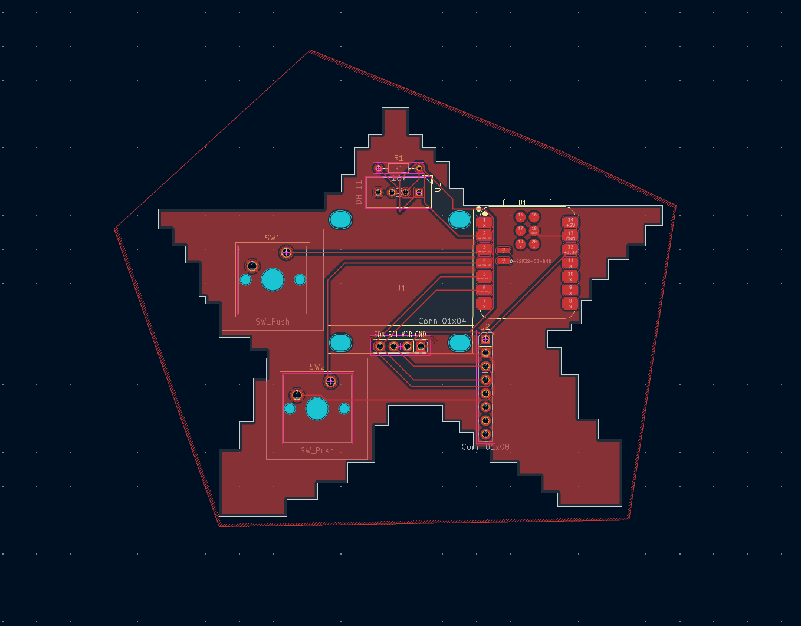

# Starbie

Starbie is a small star-shaped PCB pet that I designed in KiCad. It uses a XIAO ESP32-C3 microcontroller, a small OLED screen to show the pet, two buttons to interact with it, an MPU6050 motion sensor so it reacts when you tilt or shake it, and a DHT11 sensor to read temperature and humidity.

## Why I made it
I wanted to understand how real circuit boards are designed and made, from the schematic all the way to factory files. I also just thought it would be fun to build my own little desk pet.

## How it works
- The ESP32-C3 is the brain and runs the Arduino firmware.
- Button 1 opens a menu, and tilting the board picks an option.
- Button 2 shows the pet's stats.
- The OLED and MPU6050 share the same I2C lines (SDA and SCL).
- A ground fill on both sides of the board connects all the ground pins.

## Parts
- XIAO ESP32-C3
- 0.96" SSD1306 OLED (4-pin)
- MPU6050 module (8-pin)
- DHT11 sensor + 10k resistor
- 2 push buttons

## Pictures

## Files
- `Starbie.kicad_sch`: schematic
- `Starbie.kicad_pcb`: PCB layout
- `bom.csv`: parts list
- `starbie.jver.zip`: Gerber and drill files for manufacturing
